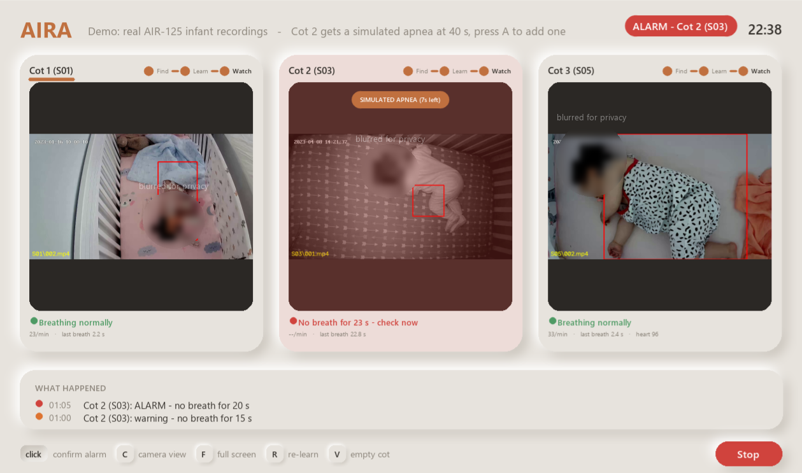
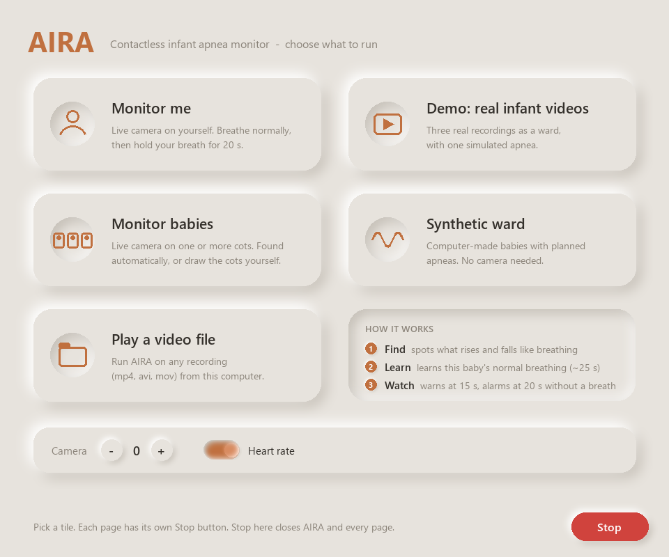

# AIRA — Apnea & Infant Respiration Analysis

Contactless apnea alerts for newborns from a camera. No wires on the baby.

> ⚠️ Research prototype. Not a medical device.



**Full write-up (PDF):** [How AIRA works and the problems it solves](docs/AIRA_How_It_Works.pdf)

## How it works

1. **Find the baby:** AIRA finds the moving chest or belly automatically, or you draw the cot.
2. **See the breathing:** it measures the tiny up-and-down motion of each breath (optical flow).
3. **Clean the signal:** it keeps breathing-speed motion and drops camera noise and big movements.
4. **Count breaths:** every breath is detected in real time, within 1 s.
5. **Apnea clock:** no breath for **10 s** gives a watch, **15 s** a pre-alert and **20 s** an **alarm** for the nurse.
6. **Never silently blind:** if it can't see well, it says so ("poor signal" or "moving").

It also shows the heart rate from tiny skin-colour changes in the face (beta).

## Results (real baby videos, public AIR-125 dataset)

Tested on babies the system was never tuned on:

- **88 %** of breaths found, **90 %** of detections were real breaths
- Breathing rate within **1 breath/min**
- **0** false apnea alarms in 63 clips

## The problem: hardware

AIRA works on ordinary webcams, which limit it:

- Webcams struggle in the **dark**, where babies sleep.
- Low-quality cameras add **noise** that can hide shallow breaths.
- A normal camera only sees **movement**, so it can't catch obstructive apnea (the chest moves but no air flows).

These are hardware limits, not limits of the method.

## Future scope

With hospital-grade hardware:

- **Infrared (night-vision) cameras:** clear view in total darkness.
- **Thermal cameras:** see the warm air at the nose, so they can catch obstructive apnea.
- **Infrared and thermal together:** chest motion plus airflow, so each one checks the other.
- **Clinical trial:** compare against wired NICU monitors on real patients.
- **Hospital integration:** send alarms to the nurse station or pagers.

## Run it

```bash
pip install -r requirements.txt
python get_models.py   # optional AI models, ~9 MB
python launcher.py     # or double-click AIRA.bat
```



Keys: `F` full screen, `C` camera view. The **Stop** button closes the page.

## Run the real-infant demo

The demo plays three real baby recordings as a ward, and Cot 2 gets a simulated apnea at 40 s.
The videos are not included (they belong to the dataset authors), so download them once:

1. Get the **AIR-125** dataset from [ostadabbas/Infant-Respiration-Estimation](https://github.com/ostadabbas/Infant-Respiration-Estimation) and follow its download instructions.
2. Put it here so the folders look like this:
   ```
   data/air125/AIR_125/S01/001.mp4
   data/air125/AIR_125/S01/001.hdf5
   ...S02, S03, S04, S05
   ```
3. Run `python launcher.py`, then click **Demo: real infant videos** (or run `python demo.py`).

The Cot 2 warning comes at about 15 s and the alarm at 20 s after the apnea starts. Press `A` to add another apnea.

## Privacy

Video never leaves the computer and is never saved. See [SECURITY.md](SECURITY.md).

MIT licence: free to use. Please credit **AIRA by Diuthendrh R D** if you use it (see [LICENSE](LICENSE)).
The write-up PDF is © 2026 Diuthendrh R D, licensed CC BY 4.0 (share with credit).
Uses Google MediaPipe and the AIR-125 dataset (not included).
